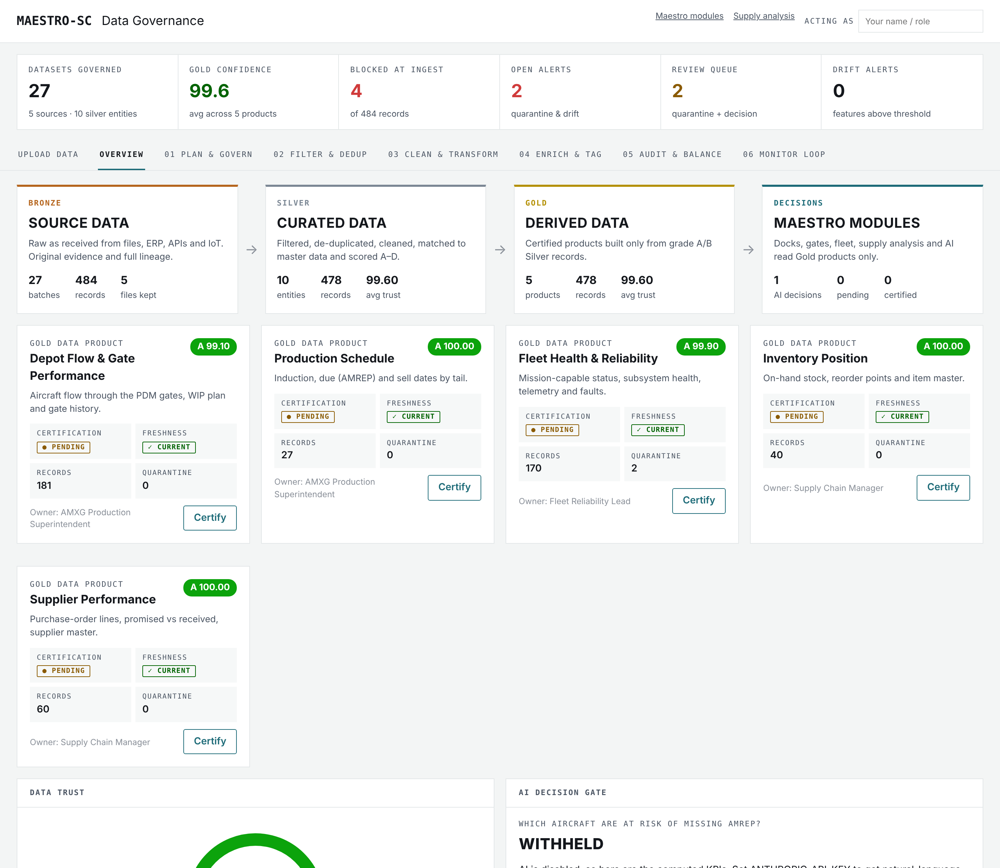
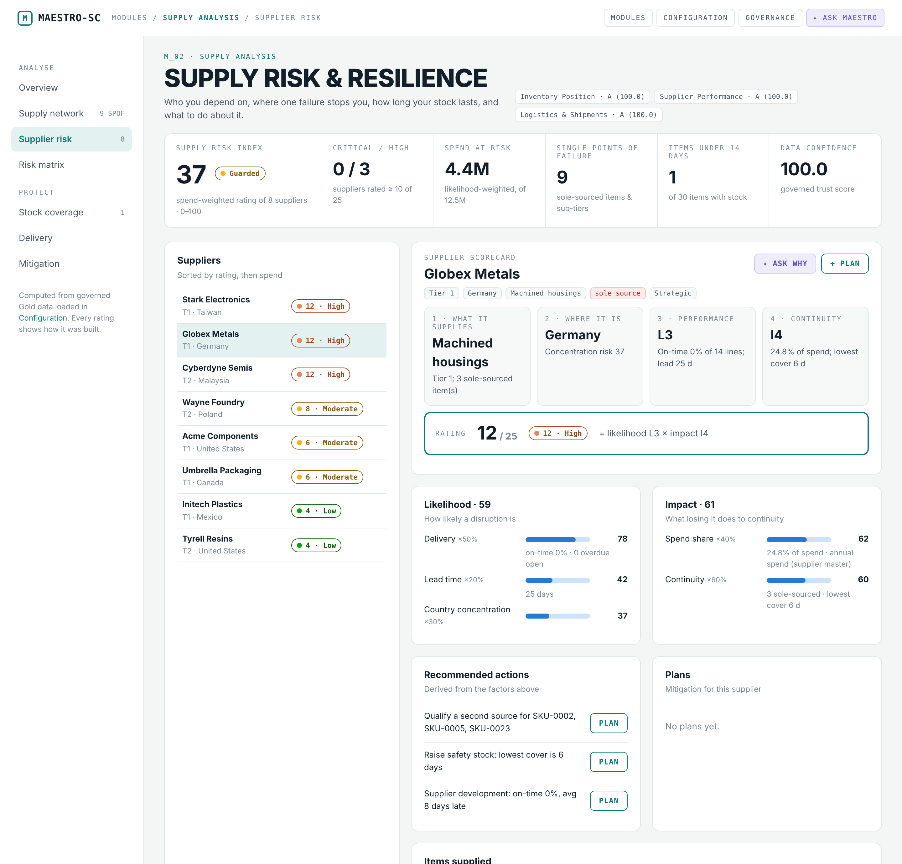
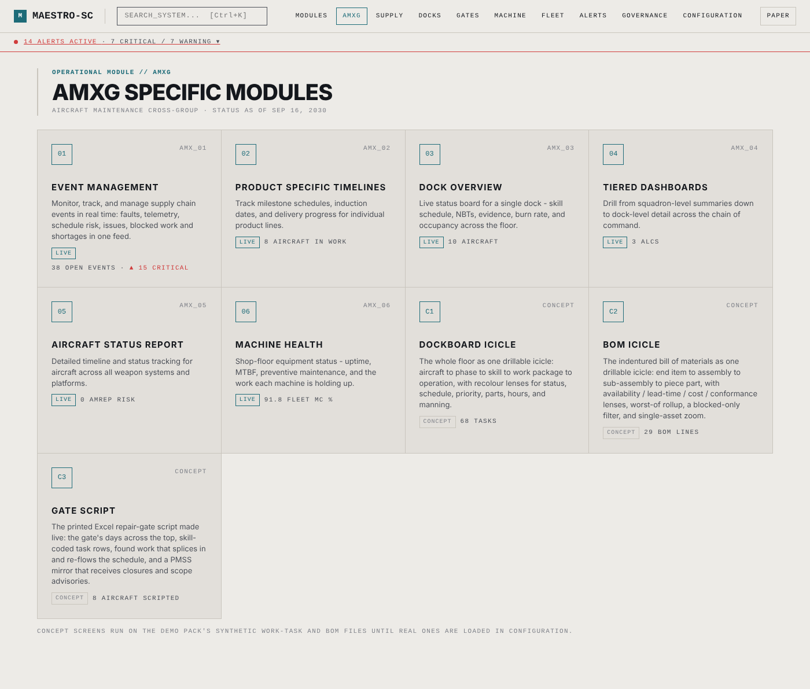

# Supply Chain AI Data Hub

Pulls supply-chain data from **any source** (Excel, CSV, JSON, PDF, emails, ERP, REST APIs, IoT), uses **AI (Claude)** to understand and normalise it, stores it in **MongoDB** (NoSQL), and turns it into supply-chain analytics plus plain-language Q&A.

It follows the same idea as Praxie (AI supply-chain workspace on connected data) and Kinaxis Maestro (data fabric → intelligence engine → user interface), as an MVP you can run and extend.

Everything runs in one application, **Maestro-SC** (http://localhost:8000/maestro):

* **Configuration** is the only place data enters: file upload, API/ERP pull and IoT. After each load it shows which module the data feeds. **Loaded data** lists every source and deletes one source, or everything. You must type the source name (or `DELETE ALL`) and your name. Deletion removes the source from Bronze, Silver, Gold and quarantine, withdraws certification of the affected Gold products, makes any older version of the same records current again, and is recorded in the audit log.
* **Modules** show the governed data: **Supply analysis** (http://localhost:8000/supply), **Docks / Gates / Machine** (depot flow) and **Fleet** (health and faults).
* **Governance** shows quality, quarantine and lineage for everything that was loaded.


## Data governance (after ingest)

Open **http://localhost:8000/governance**. It follows the DFSP IP Data Governance design: Bronze → Silver → Gold, a Data Trust Score, quarantine, certified Gold products and an AI decision gate.



| Layer / step | What happens |
|---|---|
| **Bronze** (raw evidence) | Every uploaded file is kept byte-for-byte with its SHA-256. Every sheet or table is kept as received, with a payload hash and a row hash on each record. Measure, never fix. |
| **Gate 1** (technical checks) | Parsed by a known reader and the schema maps to a Maestro entity. Otherwise the rows stay in Bronze only and count as *blocked at ingest*. A malware scan is **not** configured. |
| **Silver** (trusted and scored) | Cleaned and conformed. Duplicate copies are removed; for snapshots, the newest version is kept and older ones go to history. Records are matched to the fleet master and tagged with domain and sensitivity (CUI). Every record gets a **Data Trust Score** from six dimensions: completeness 20, validity 20, timeliness 20, consistency 20, uniqueness 10, provenance 10. That gives grade **A ≥ 95 · B ≥ 85 · C ≥ 70 · D**. |
| **Quarantine** | Grade D or a hard rule (missing identity key, code not in the approved list, bad tail number, negative quantity, rate outside 0–100) sends the record to quarantine. It gets a reason code, the domain's steward and an SLA. Records are never edited in place: when the source sends a corrected version, the item resolves itself. |
| **Gold** (certified products) | Six products: Depot Flow, Production Schedule, Fleet Health, Inventory, Supplier Performance and Logistics. Each is built only from A/B records. **Gate 2:** product grade ≥ B *and* the data owner certifies. New data after certification shows **RECERTIFY**. The trust label travels with the data; for example, gate graphs carry it. **Maestro modules and supply analytics read Gold only.** |
| **AI decision gate** | Data grade × model confidence gives *recommend*, *recommend with caveat*, *advisory* or *withhold*. Accept, Modify and Override are recorded; an override requires a reason. Without an API key, recommendations are withheld. |
| **Monitor loop** | Records graded A/B (target ≥ 95%), quarantine aging (target < 5 days), acceptance and override rates, and drift alerts (newest load of a sheet vs earlier loads). |
| **Audit & balance** | Control totals per batch (received = blocked + silver + quarantine + duplicate + history + replaced) and an audit log of every governance action. |

**Drill-down:** every number on the governance page opens the records behind it. Facets let you narrow by entity, layer, grade, issue and source. Clicking a record shows its six dimension scores, each issue (a hard rule or a deduction), its quarantine status, every version of it, and its lineage: Bronze file (SHA-256) → batch and Gate 1 result → the exact source row → Silver → Gold, or why it was excluded. Bronze batches open to show the content exactly as received. In Maestro, tail numbers on dock cards and gate-graph bars open that aircraft's records. A module with no Gold data explains why: nothing loaded, quarantined, grade C, or blocked at Gate 1.

Weights, grade thresholds, SLA, drift threshold and roles are editable under **01 Plan & govern**. They stay proposals until a governance council ratifies them, and changing them re-scores everything and is audited. Actions are recorded against the name in **Acting as**. There is no login yet, so this is not access control.

## Supply analysis (risk & resilience)

Open **http://localhost:8000/supply**. It's a light-theme screen computed only from governed Gold supply data: supplier master, purchase orders, inventory, item master and customer orders. The samples are in `samples/` (`supplier_master.csv`, `sales_orders.csv`, `inventory.xlsx`, `purchase_orders.csv`).



| View | What it shows |
|---|---|
| Overview | Supply risk index (spend-weighted, 0–100), critical/high suppliers, spend at risk, single points of failure, items under 14 days of cover, data confidence; plus what needs attention, the rating mix and spend by country |
| Supply network | Sub-tier → tier 1 → items → sites → customers. Click a node to trace what it depends on and what it feeds. Sole-sourced items and sub-tiers are marked as single points of failure |
| Supplier risk | Scorecard per supplier: rating = **likelihood × impact** (1–5 each), built in four shown steps. Likelihood = 50% delivery + 20% lead time + 30% country concentration, over the factors with data. Impact = 40% spend share + 60% continuity (sole sourcing × days of cover). A sub-tier inherits the impact of the supplier it feeds, and missing inputs widen the ± range. Shows recommended actions, plans and items, plus "Ask why" (AI, through the decision gate) |
| Risk matrix | 5×5 likelihood × impact grid and the risk register |
| Stock coverage | Days of cover per item (demand from customer orders; purchase orders as a proxy), run-out date, next receipt, and a safety-stock what-if: suggested reorder point = daily demand × (lead time + buffer days) |
| Delivery | On-time trend by month and late or overdue lines |
| Mitigation | Supplier segmentation (supply risk × business impact, split at the median: strategic, bottleneck, leverage, non-critical) with a strategy per segment. A 4T plan board (Treat / Transfer / Tolerate / Terminate) moves plans through Proposed → Approved → In progress → Done; every move is audited |

The weights and thresholds are starting proposals. They are documented in `app/supply_risk.py` so they can be agreed and tuned.

### External risk feeds (free, daily)

The app pulls these public sources once a day, at `RISK_FEEDS_HOUR` UTC (default 02:00), and at start-up if the last run is over a day old. **Configuration → Risk feeds** shows each feed's status (OK, PARTIAL or ERROR), lets you switch feeds on and off, and has **Refresh now**. Feeds are governed like any other source (Bronze copy with hash → `risk_signal` records → Gold) and appear under **Supply analysis → Risk signals**.

| Feed | Source | Used for | What leaves your network |
|---|---|---|---|
| OFAC SDN list | US Treasury | possible sanctions matches (entities only, matched locally) | nothing |
| UK Sanctions List | UK FCDO | possible sanctions matches (entities only, matched locally) | nothing |
| GDACS alerts | UN OCHA / EU JRC | orange and red disaster alerts (droughts and wildfires weighted down) | nothing |
| USGS earthquakes | US Geological Survey | magnitude 5+ in the last 7 days | nothing |
| Political stability | World Bank WGI (`GOV_WGI_PV.EST`) | country stability (no data for Taiwan) | nothing |
| Unrest news | GDELT | 3-day news volume vs the usual level, per supplier country | country names only |

They feed a 4th likelihood factor, **geopolitical & hazard** = max(serious hazard, 60% stability + 40% unrest). The likelihood weights become 40% delivery, 15% lead time, 20% concentration and 25% geopolitical & hazard. A possible sanctions match sets the factor to 100 and adds "verify" as the first action. Matches are name-only, so confirm identity before acting.

Limits:
* Hazards are matched by **country**, because supplier site coordinates are not loaded. Only serious events (score ≥ 60) change ratings; smaller ones are only shown.
* GDELT rate-limits heavily. Countries it refuses are reported, and the feed shows PARTIAL.
* Hosts to allow in a restricted network: `www.treasury.gov`, `sanctionslistservice.ofac.treas.gov`, OFAC's download redirect to `*.s3.us-gov-west-1.amazonaws.com`, `sanctionslist.fcdo.gov.uk`, `www.gdacs.org`, `earthquake.usgs.gov`, `api.worldbank.org`, `api.gdeltproject.org`.
* Set `RISK_FEEDS_ENABLED=false` where the app has no internet access.

## Maestro-SC module (depot / maintenance)

Open **http://localhost:8000/maestro#config** (Configuration) and load the files in `samples/maestro/`.


| View | What it shows | Built from |
|---|---|---|
| Modules | The 14 Maestro components. Built ones are marked LIVE, the rest DESIGN | – |
| Docks (AMX_03) | One card per aircraft in work: current gate, Day x/goal, Flow x/AMREP days, In-dock x/goal, Queue, milestones, next big thing, notes, AMREP risk | PDM tail sheets |
| Gates | Gate graph per *FIXER DATA TO GRAPHS* process: last X aircraft (default 6) + aircraft in the gate (actual + remaining), rolling last-X average, requirement, and the WIP plan vs actual inset | tail sheets + Machine Info |
| Machine | Last-X average days per gate and queue vs requirement, last-X flow and in-dock days, last aircraft produced | same |
| Fleet | MC rate with FMC/PMC/Degraded/NMC band, MTBM vs target, subsystem health, telemetry against limits, fault registry | Dashboard supporting data |
| Alerts | Critical and warning alerts from the fault registry, telemetry breaches, AMREP risk and gate overruns | all |

### AMXG specific modules

Open **http://localhost:8000/maestro#amxg** (or **AMXG** in the top bar).



| Card | Screen | Built from |
|---|---|---|
| AMX_01 Event management | One feed of fault-registry entries, telemetry breaches, AMREP and gate risks, the issue register, blocked work and supply shortages. Filter by state, source and level; acknowledge, assign, close or reopen (each action asks for a name and goes in the audit log) | all depot, fleet and supply data |
| AMX_02 Product specific timelines | Gantt of every aircraft through the gates: queues vs gates, gates over goal, AMREP date, projected/actual finish, an as-of line. Filters All / In work / Sold-delivered / Incoming | tail sheets + FY schedule |
| AMX_03 Dock overview | The Docks board | tail sheets |
| AMX_04 Tiered dashboards | Drill AFSC → ALC → weapon system → B-52 PDM line → dock → aircraft. Produced vs goal by quarter, attainment, on-time, hours, yield, open issues at each level; the PDM line adds WIP-over-plan and slow gates | ALC summary + issue register + tail sheets |
| AMX_05 Aircraft status report | Aircraft × gate grid (days / goal, in gate now, over goal), AMREP margin, health band, blocked work; a detail panel per aircraft | tail sheets + fleet + work tasks |
| AMX_06 Machine health | The Fleet view. It reads any `asset_status` / `subsystem_health` / `fault` / telemetry data, so shop equipment loaded the same way appears here too | dashboard data |
| Concept: Dockboard icicle | Floor → dock → aircraft → gate → skill → work package → task, width = planned hours, click to zoom. Lenses: status, schedule against the script, priority, parts, hours charged vs planned, skill backlog | work tasks |
| Concept: BOM icicle | End item → system → assembly → piece part. Lenses: availability (worst-of rollup), supplier lead time, extended cost, supplier on-time conformance. Blocked-only filter and single-aircraft zoom (only the parts its open work needs) | BOM + supply data + work tasks |
| Concept: Gate script | The gate's days across the top, task rows grouped by skill code, today and goal lines. **+ Found work** splices a task into a work package and pushes overlapping not-started tasks after it; **Close** completes a task. Both appear in the PMSS mirror, which only records what would be sent: PMSS is not connected | work tasks |

Work tasks (`work_task`: tail, gate, skill, work package, task, planned start day and days, hours, status, found work, part) and BOM lines (`bom_line`: parent, child, quantity, level, end item) are new entity types and are governed like everything else. Acknowledgements, closures and found work added on screen are stored beside the data (`amxg_overlay`) and never change the governed records; **Delete all data** clears them too.


How the workbooks are read:
* **Tail sheets** are recognised by their labels (`G1 Q … Post Dock`, `# of Actual Days`), not by fixed cells, so inserted rows don't break them. Green and blue tabs are kept as `tab_color`, and in-work vs produced comes from the actual finish date. A queue left open on the sheet counts as finished once a later gate has started (on or before the sheet's "Today's Date"). A mismatch between the sheet name and cell D1 is flagged as a data check.
* **Sheets with a data dictionary above the table** (Dashboard supporting data): the real header row is detected and the dictionary is passed to the AI as context. Side-by-side copies of a table are merged into one.
* **Scanned status boards** (PDF/photo): Claude reads them visually into per-aircraft records. Without an API key they are skipped rather than turned into junk rows.

## Architecture

```
 Sources                         Ingestion + AI                       Storage (MongoDB)        Use
 ───────                         ─────────────                        ────────────────         ───
 Excel / CSV / JSON  ─┐                                               raw       (untouched    Dashboard (web/)
 PDF / scans / email ─┤  connectors/  ──►  AI mapping & extraction ──► payloads, lineage)     KPIs & risk lists
 ERP (OData / REST)  ─┤  files.py          (app/ai/claude.py)         records   (canonical    "Ask AI" Q&A
 REST APIs           ─┤  remote.py         cached per table layout     schema, flexible       REST API
 IoT (HTTP / MQTT)   ─┘                                               attributes)
                                                                      mappings  (AI cache)
                                                                      sources
```

**How the AI reads the data**

| Data shape | What the AI does | Cost |
|---|---|---|
| Tables (Excel sheets, CSV, ERP/API JSON, IoT payloads) | Claude sees the headers plus 8 sample rows. It works out the record type (inventory, PO, shipment...) and maps each column to the canonical schema, including ERP technical names like `MATNR`, `EBELN` and `LABST`. The mapping is **cached by column layout**, so a nightly file with the same layout never calls the AI again. | one small call per new layout |
| Unstructured (PDFs incl. scanned, emails, text) | Claude reads the whole document and extracts one record per line item. | one call per document |
| Questions ("which suppliers put SKUs at risk?") | KPIs, risk lists and samples go to Claude, which answers with findings and actions. | one call per question |

Without an API key the app still works. A rule-based header matcher (with SAP synonyms) and PDF table extraction stand in for the AI.

**Canonical model** (`app/models.py`): `inventory`, `purchase_order`, `sales_order`, `shipment`, `supplier`, `product`, `sensor_reading`. Common fields (sku, quantity, supplier, dates...) are indexed. Anything else from the source is kept in `attributes`, so new sources never need a schema migration. That is the main reason to use a NoSQL store here.

**Analytics** (`app/analytics.py`): inventory value, SKUs below reorder point, stockouts, supplier on-time rate, lead time and spend, late PO lines, delayed shipments, demand by SKU, and IoT anomalies (z-score per device and metric, e.g. cold-chain temperature excursions).

## Run it

With Docker (MongoDB + app):
```bash
export ANTHROPIC_API_KEY=sk-ant-...
docker compose up --build
```

Or locally with an in-memory database:
```bash
pip install -r requirements.txt
MONGO_URI=mongomock:// uvicorn app.main:app --reload
```
Open http://localhost:8000. It goes to Maestro's Supply module. Load the files from `samples/` and `samples/maestro/` in **Configuration** (`python samples/make_samples.py` regenerates the supply samples).

Tests: `pytest -q` (75 tests, including the Maestro reference workbooks and the governance rules)

## API

| Endpoint | Purpose |
|---|---|
| `POST /api/ingest/file` | Upload Excel / CSV / JSON / PDF / TXT / EML (`source`, optional `record_type`) |
| `POST /api/ingest/api` | Pull a REST API or ERP OData endpoint. Follows `@odata.nextLink`, `d.__next` and `Link` paging. Supports basic auth or headers. |
| `POST /api/ingest/iot/{source}` | Devices or gateways push JSON readings |
| `POST /api/ingest/mqtt/start` / `stop/{source}` | Subscribe to an MQTT broker topic |
| `GET /api/analytics/overview` and `/api/analytics/{inventory,suppliers,shipments,demand,iot}` | KPIs |
| `POST /api/ask` | Natural-language question → answer, findings, actions |
| `GET /api/records`, `/api/sources`, `/api/mappings` | Browse data, sources and the AI's learned mappings |
| `GET /api/amxg/hub`, `/events`, `/timelines?filter=`, `/tiered`, `/status`, `/dockboard`, `/bom?asset=`, `/script/{tail}?gate=` | AMXG screens |
| `POST /api/amxg/events/{id}`, `/api/amxg/script/{tail}/close`, `/api/amxg/script/{tail}/found-work` | Acknowledge / close events, close tasks, add found work (audited) |

ERP examples: SAP S/4HANA (`/sap/opu/odata/sap/API_PURCHASEORDER_PROCESS_SRV/A_PurchaseOrderItem`, records path `d.results`), Dynamics 365 (`/data/PurchaseOrderLinesV2`), plus Oracle Fusion, NetSuite and Odoo REST endpoints.

## Configuration

| Variable | Default |
|---|---|
| `MONGO_URI` | `mongodb://localhost:27017` (`mongomock://` = in-memory) |
| `ANTHROPIC_API_KEY` | – (unset → rule-based mode) |
| `AI_MODEL` | `claude-opus-5-5` |
| `AI_ENABLED` | `true` |

To use a different AI vendor, implement `map_columns`, `extract_document` and `answer` (see `app/ai/provider.py`) and return your class from `get_provider()`.

## Roadmap to production
- Auth / multi-tenant (an org id on every document), plus a secrets vault for connector credentials
- Scheduled pulls (store connector configs in `sources`, run them with Celery/APScheduler)
- Large volumes: move analytics into MongoDB aggregation pipelines and use time-series collections for IoT
- Human review screen to correct AI mappings (edit `mappings`, then re-process `raw`)
- Demand forecasting and what-if scenarios (the Maestro-style planning layer)
